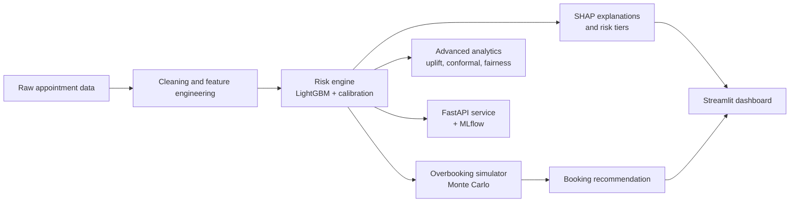

# 🏥 ClinicSense

### Patient No-Show Risk Engine & Dynamic Overbooking Optimizer

*Predict who will miss an appointment. Decide how many extra patients to book. Cut idle doctor time.*

**Student:** Kadam Akanksha Dinkar  &nbsp;|&nbsp; **Programme:** B.Sc. Data Science Honours
**Project Guide:** Dr. Madhavi


## 🎯 Overview

Outpatient clinics lose a large share of booked appointments to no-shows. Every missed slot wastes doctor time, reduces revenue and delays care for other patients. Most clinics either ignore the problem or overbook by a fixed number, whatever the day's patient mix.

**ClinicSense** is an end-to-end **predictive + prescriptive analytics** system that answers three questions:

| # | Question | How ClinicSense answers it |
|---|----------|---------------------------|
| 1 | **Who** is likely to miss their visit? | Calibrated ML risk scores (LightGBM) |
| 2 | **Why**, and what can we do? | SHAP explanations, causal SMS analysis, uplift targeting |
| 3 | **How many** extra patients should we book? | Monte Carlo simulator with risk-based dynamic overbooking |

---

## ✨ Highlights

- 🔮 **Five models** compared (Logistic Regression, Random Forest, XGBoost, LightGBM, Stacking), tuned with Optuna and calibrated with isotonic regression
- 🔍 **Explainable:** SHAP global and per-patient explanations, Low / Medium / High risk tiers
- 🎲 **Prescriptive:** Monte Carlo simulation of 5,000 clinic days per strategy
- 🧪 **Research extensions:** survival analysis, causal inference, newsvendor optimisation, TabNet, fairness mitigation, reinforcement learning
- 🚀 **Deployable:** FastAPI service, MLflow tracking and a six-tab Streamlit dashboard

---

## 🏗 System Architecture



---

## 📊 Dataset

**Source:** Kaggle, [Medical Appointment No Shows](https://www.kaggle.com/datasets/joniarroba/noshowappointments) (public clinics in Vitória, Brazil).

| Item | Value |
|------|-------|
| Raw rows | 110,527 |
| Rows after cleaning | **71,959** |
| Unique patients | 45,840 |
| Date range | 29 Apr 2016 to 8 Jun 2016 |
| No-show rate (cleaned) | **28.5%** (20,522 no-shows, 51,437 shows) |
| Model features | 21 |

Cleaning (`src/data_loader.py`) removes negative ages, appointments scheduled after the visit date and duplicate appointment IDs.

> 📥 Download `KaggleV2-May-2016.csv` and place it at `data/KaggleV2-May-2016.csv`. The test suite does **not** need it.

---

## 🔬 Methodology

| Stage | What was done |
|-------|---------------|
| **1. EDA** | Class balance, age, weekday and lead-time analysis; Mann-Whitney U and chi-square tests (all significant at α = 0.05) |
| **2. Feature engineering** | Lead time, same-day booking, weekday and month flags, prior appointments, prior no-shows, prior no-show rate, condition count, age group, neighbourhood frequency encoding |
| **3. Class imbalance** | SMOTE on the training set only, plus class weights (`class_weight='balanced'`, `scale_pos_weight`) |
| **4. Modelling** | Five models, Optuna search for LightGBM, isotonic calibration |
| **5. Interpretation** | SHAP, risk tiers, what-if analysis |
| **6. Simulation** | 5,000 days per strategy, 20 slots/day, 40 patients in each pool; idle slot ₹150, waiting ₹2/min, overtime ₹5/min |

**Risk-based dynamic rule:** `extra_bookings = round( Σ (1 − attend_prob_i) )` over the day's booked patients.

---

## 🏆 Results

All figures come from the executed notebooks (held-out test set of 14,392 rows).

### Model comparison

| Model | ROC-AUC | PR-AUC | Recall | F1 |
|-------|:-------:|:------:|:------:|:--:|
| Logistic Regression | 0.608 | 0.385 | 0.571 | 0.434 |
| Random Forest | 0.598 | 0.369 | 0.430 | 0.392 |
| XGBoost | 0.636 | 0.423 | 0.559 | 0.452 |
| **LightGBM** ⭐ | **0.637** | **0.424** | 0.552 | **0.453** |
| Stacking Ensemble | 0.592 | 0.391 | 0.222 | 0.295 |

After tuning and calibration, LightGBM's Brier score improves from 0.230 to **0.202**, giving more trustworthy probabilities for the simulator.

### Risk tiers

| Tier | Share of patients | Actual no-show rate |
|------|:-----------------:|:-------------------:|
| 🟢 Low | 54.5% | 22.7% |
| 🟡 Medium | 38.9% | 33.5% |
| 🔴 High | 6.6% | 47.3% |

**Top SHAP drivers:** neighbourhood frequency, prior no-show rate, appointment weekday, Monday flag, prior no-shows, lead time.

### Overbooking strategies

| Strategy | Avg daily cost (₹) | Utilisation |
|----------|:------------------:|:-----------:|
| No overbooking | 928 | 69% |
| Fixed +3 | 632 | 79% |
| Fixed +5 | 434 | 86% |
| **Risk-based dynamic** ⭐ | **406** | **99%** |

The risk-based policy cuts simulated daily cost by about **56%** (roughly ₹130,000 a year under the assumed costs). Trade-off: more overflow, about 2.65 patients and 53 minutes of overtime per day.

### Other findings

- **Conformal prediction (MAPIE):** 90.0% coverage, 81.6% single-label sets
- **Patient segments (K-Means, k = 4):** Chronic Patients, High-Risk First-Timers, Reliable Regulars, Last-Minute Bookers
- **SMS uplift (T-Learner):** mean uplift +4.0 percentage points; Chronic Patients benefit most
- **Q-Learning agent:** ₹862/day against ₹3,527 for risk-based dynamic overbooking, so the rule-based policy stays the recommendation

> ℹ️ Notebooks 09–13 (survival, causal, uncertainty, deep tabular, fairness mitigation) describe findings in text, for example IPW and doubly robust SMS effects of about −2.5 and −2.9 points after adjusting for confounding. Those notebooks were not saved with executed outputs, so re-run them before quoting exact figures.

---

## 🧩 Modules

| Part | Module | Description |
|:----:|--------|-------------|
| 1 | **Risk Engine** | LR, RF, XGBoost, LightGBM, Stacking; calibration; cost-sensitive threshold |
| 2 | **Overbooking Simulator** | Monte Carlo, three strategy families, cost heatmap |
| 3 | **Advanced Analytics** | SHAP, K-Means/GMM, T-Learner uplift, PSI drift, MAPIE conformal, Fairlearn audit |
| 4 | **Reinforcement Learning** | Tabular Q-Learning overbooking agent |
| 5A | **Survival Analysis** | Kaplan-Meier, Nelson-Aalen, Cox PH on lead time |
| 5B | **Causal Inference** | IPW / doubly robust ATE, CATE, budget-constrained SMS targeting, Qini curve |
| 5C | **Uncertainty Optimisation** | Conformal bounds with Newsvendor overbooking |
| 5D | **Deep Tabular Models** | TabNet and MLP vs boosting, DeLong and McNemar tests |
| 5E | **Fairness Mitigation** | ThresholdOptimizer, ExponentiatedGradient |
| 5F | **MLOps** | FastAPI, MLflow, model metadata export |

---

## 📁 Project Structure

```
ClinicSense/
├── data/                       # Raw CSV and generated artefacts (not in repo)
├── notebooks/                  # 01 EDA ... 14 MLOps (run in order)
├── src/
│   ├── config.py               # Constants and paths
│   ├── data_loader.py          # Load and validate CSV
│   ├── preprocessing.py        # Outliers, encoding, splits
│   ├── feature_engineering.py  # Engineered features
│   ├── models.py               # LR, RF, XGBoost, LightGBM, Stacking
│   ├── evaluation.py           # Metrics, curves, threshold tuning
│   ├── simulator.py            # Monte Carlo overbooking simulator
│   ├── advanced_analytics.py   # SHAP, clustering, uplift, PSI, conformal, fairness
│   ├── rl_agent.py             # Q-Learning agent
│   ├── survival.py             # KM, Nelson-Aalen, Cox PH
│   ├── causal_inference.py     # IPW/DR, CATE, SMS optimiser
│   ├── uncertainty_optimization.py
│   ├── deep_tabular.py         # TabNet, MLP, statistical tests
│   ├── fairness_mitigation.py
│   ├── api_server.py           # FastAPI + MLflow
│   └── report_writer.py        # Markdown and CSV reports
├── dashboard/app.py            # Streamlit dashboard
├── tests/                      # pytest suite (synthetic data)
├── outputs/                    # Figures, models, reports (generated)
├── run_all.py                  # Run notebooks end to end
├── requirements.txt
└── README.md
```

<details>
<summary><b>📓 Notebook order and dependencies</b></summary>

| Notebook | Purpose | Writes |
|----------|---------|--------|
| 01 | Data collection and EDA | n/a |
| 02 | Preprocessing and features | `splits.joblib`, `smote_splits.joblib`, `processed_data.csv` |
| 03 | Predictive modelling | `model_probs.joblib`, models |
| 04 | Evaluation, tuning, calibration | `best_model_output.joblib` |
| 05 | SHAP and risk stratification | figures |
| 06 | Overbooking simulator | simulation report |
| 07 | Advanced analytics | `segmented_data.csv`, figures |
| 08 | Reinforcement learning | RL report |
| 09–13 | Survival, causal, uncertainty, deep tabular, fairness | figures, reports |
| 14 | MLOps deployment | `model_metadata.json` |

Run them **in order**; later notebooks read files written by earlier ones.
</details>

---

## 🚀 Getting Started

**Requirements:** Python 3.10 (3.11 should also work).

```bash
# 1. Create and activate a virtual environment
python -m venv .venv
.\.venv\Scripts\Activate.ps1        # Windows PowerShell
# source .venv/bin/activate          # macOS / Linux

# 2. Install dependencies
pip install -r requirements.txt

# 3. For automatic notebook execution
pip install nbconvert ipykernel
python -m ipykernel install --user --name python3
```

Then add the dataset at `data/KaggleV2-May-2016.csv`.

---

## 💻 Usage

| Goal | Command |
|------|---------|
| Run **EDA + preprocessing** automatically | `python run_all.py --nb 01 02` |
| Run **all notebooks** end to end | `python run_all.py` |
| Run selected notebooks | `python run_all.py --nb 03 04 06` |
| Open the EDA notebook interactively | `jupyter notebook notebooks/01_data_collection_eda.ipynb` |
| Launch the dashboard | `streamlit run dashboard/app.py` |
| Start the prediction API | `uvicorn src.api_server:app --reload` |
| Run the tests | `python -m pytest` |

> ⏱ NB03 (stacking) can take 10 to 20 minutes on modest hardware; the Optuna search in NB04 adds a few more.

---

## 🖥 Dashboard and API

**Streamlit dashboard** at `http://localhost:8501`:

| Tab | What it shows |
|-----|---------------|
| 📊 Executive Overview | KPI cards, appointment status, SMS effectiveness, weekly trend |
| 🎯 Patient Risk Assessment | Capacity gauge, probability histogram, schedule with risk badges |
| ⚙️ Resource Optimization | Doctor workload, slot optimisation, overcrowding alerts |
| 📈 Attendance Analytics | Risk by age group, repeat no-show patients, SMS effect |
| 🔬 What-If Simulator | Slider for 0–10 extra bookings with expected shows and overflow risk |
| 🤖 AI Clinic Assistant | Rule-based Q&A on the day's schedule |

It loads `outputs/models/best_model_calibrated.joblib` and falls back to a rule-based formula if the model file is missing.

**FastAPI service** (Pydantic-validated):

| Endpoint | Purpose |
|----------|---------|
| `GET /health` | Health and readiness check |
| `POST /predict` | No-show probability and risk category for one appointment |
| `POST /recommend_overbooking` | Batch scheduling recommendation |

Experiments and metrics are tracked with **MLflow**.

---

## ✅ Testing

```bash
python -m pytest
```

16 test modules run on synthetic data, so no Kaggle CSV is needed. Last recorded result: **114 passed, 3 skipped**.

---

## ⚠️ Limitations

- **Scope:** one city and about six weeks of data, so results may not generalise.
- **Predictive ceiling:** about 0.64 ROC-AUC on held-out data; motivation, transport and weather are not recorded. Cross-validation scores near 0.84 were measured on SMOTE-resampled folds and are optimistic.
- **Threshold:** the cost-sensitive optimum was 0.03, which flags almost every patient. Probabilities are therefore used for ranking and simulation, not as a hard yes/no, and the fairness audit at that threshold shows near-zero gaps for the same reason.
- **Assumed costs:** cost parameters are assumptions, not real clinic finances.
- **Causal assumptions:** estimates assume no unobserved confounders.
- **Time robustness:** a train-early / test-later split gave ROC-AUC 0.563.

---

## 🔭 Future Work

- [ ] Multi-clinic data and real cost records
- [ ] Live A/B test of risk-targeted SMS reminders
- [ ] Online learning and production drift monitoring
- [ ] DQN or causal forests for scheduling and treatment-effect estimation
- [ ] Intersectional fairness evaluation

---

## 🛠 Tech Stack

`Python` · `pandas` · `NumPy` · `scikit-learn` · `XGBoost` · `LightGBM` · `SHAP` · `imbalanced-learn` · `Optuna` · `MAPIE` · `Fairlearn` · `scikit-uplift` · `lifelines` · `pytorch-tabnet` · `FastAPI` · `MLflow` · `Streamlit` · `Plotly` · `Matplotlib` · `Seaborn` · `SciPy` · `statsmodels` · `pytest`

---

## 🙏 Acknowledgements

Sincere thanks to the project guide, **Dr. Madhavi**, for her guidance and support throughout this project, and to the Kaggle community for the public *Medical Appointment No Shows* dataset.


**Built by Kadam Akanksha Dinkar** · B.Sc. Data Science Honours

